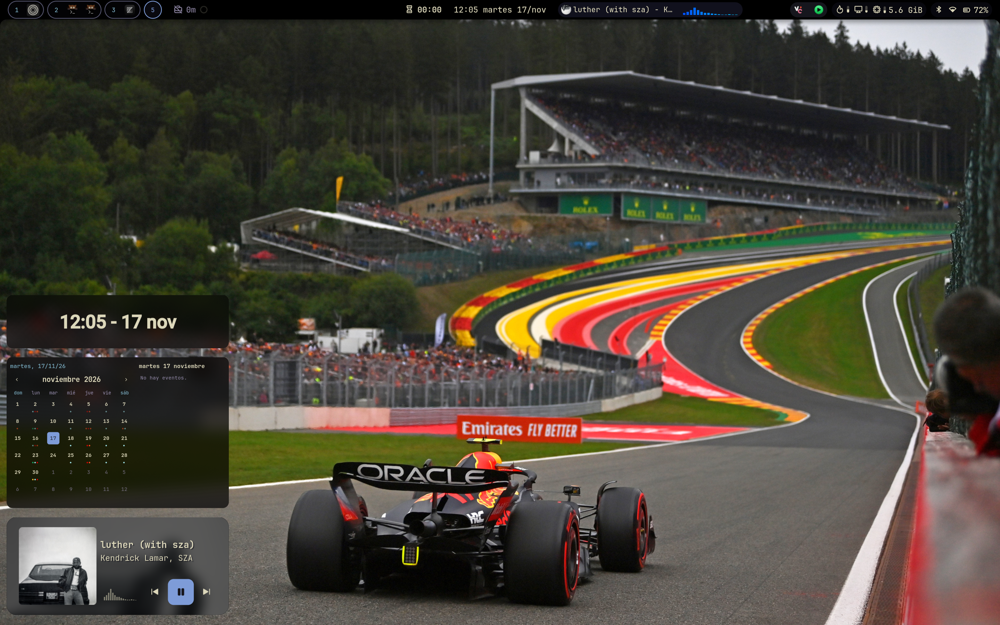
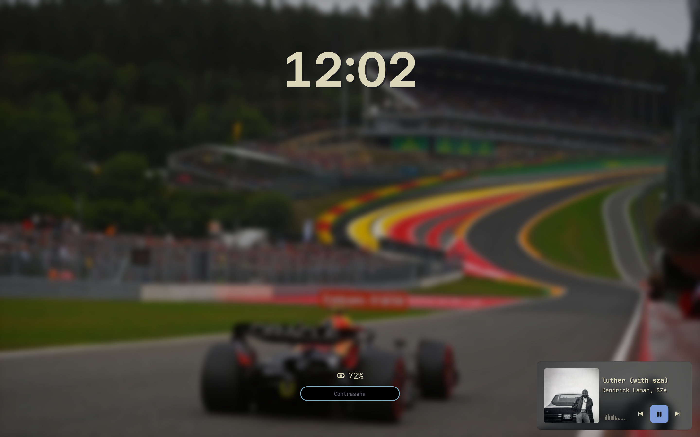

<div align="center">

#  dotfiles

**CachyOS · Hyprland · Noctalia · GNU Stow**

Mi entorno de escritorio para el ASUS Zenbook 14 OLED, todo versionado y reproducible con un solo comando.




</div>

---

## Índice

- [Galería](#galería)
- [Hardware](#hardware)
- [Sistema base](#sistema-base)
- [Noctalia: el shell del escritorio](#noctalia-el-shell-del-escritorio)
- [Software y herramientas](#software-y-herramientas)
- [Scripts y automatizaciones](#scripts-y-automatizaciones)
- [Atajos de teclado](#atajos-de-teclado)
- [Estructura del repositorio](#estructura-del-repositorio)
- [Instalación](#instalación)
- [Mantenimiento con `dots`](#mantenimiento-con-dots)
- [Licencia](#licencia)

---

## Galería

| Lanzador | Centro de control |
|:---:|:---:|
|  |  |
| **Pantalla de bloqueo** | **Terminal** |
|  |  |

---

## Hardware

| Componente | Detalle |
|---|---|
| **Equipo** | ASUS Zenbook 14 OLED (`UM3406HA`) |
| **CPU** | AMD Ryzen 7 8840HS: 8 núcleos / 16 hilos, hasta 5.13 GHz (Zen 4, `znver4`) |
| **GPU** | AMD Radeon 780M (RDNA 3 integrada, `vulkan-radeon` / Mesa) |
| **RAM** | 16 GB LPDDR5X |
| **Almacenamiento** | NVMe SSD PCIe 4.0 con **Btrfs** (snapshots con Snapper, `fstrim.timer` activo) |
| **Pantalla interna** | 14" OLED, 2880×1800 (16:10), 120 Hz, 0.2 ms, escala 1.6 |
| **Pantalla externa** | BenQ GW2283 22", 1920×1080 @ 60 Hz |

---

## Sistema base

| | |
|---|---|
| **Distribución** | CachyOS x86_64 (rolling release basada en Arch, compilada para `znver4`) |
| **Kernel** | `linux-cachyos` 7.3.1 (planificador BORE y ajustes térmicos) |
| **Sesión** | UWSM (Universal Wayland Session Manager) sobre systemd |
| **Compositor** | Hyprland 0.57.0, Wayland nativo, configuración modular en **Lua** |

### Configuración de Hyprland (`~/.config/hypr/`)

| Archivo | Función |
|---|---|
| `animations.lua` | Animaciones |
| `autostart.lua` | Programas al iniciar sesión |
| `binds.lua` | Atajos de teclado |
| `colors.lua` | Colores |
| `decorations.lua` | Bordes, sombras, blur |
| `environment.lua` | Variables de entorno |
| `inputs.lua` | Teclado, touchpad |
| `misc.lua` | Opciones varias |
| `monitors.lua` | Monitores y escalas |
| `variables.lua` | Variables generales |
| `windowrules.lua` | Reglas de ventanas |
| `workspaces.lua` | Espacios de trabajo |
| `hypridle.conf` | Gestor de inactividad |
| `xdph.conf` | Portal de escritorio (`xdg-desktop-portal-hyprland`) |
| `shaders/night-light.glsl` | Filtro de luz nocturna pensado para cuidar la pantalla OLED |

---

## Noctalia: el shell del escritorio

El ricing gira alrededor de **Noctalia**, una suite de escritorio para Hyprland escrita en Rust/QML que unifica todos estos componentes:

- **Barra superior:** espacios de trabajo dinámicos, reloj y fecha, título de la ventana activa, temperatura del Ryzen, uso de CPU/RAM, red, batería y visualizador de audio.
- **Lanzador de aplicaciones**
- **Conmutador de ventanas** (estilo Alt-Tab)
- **Centro de control:** Wi-Fi, Bluetooth, modo cafeína, perfiles de energía y notificaciones.
- **Selector de fondos de pantalla** con integración a Wallhaven y Swash.
- **Historial del portapapeles** y **selector de emojis**
- **Pantalla de bloqueo** y menú de sesión (apagar, reiniciar, suspender)

### Paletas de color dinámicas

Noctalia incluye 9 paletas JSON. El tema elegido se sincroniza automáticamente con **Kitty, Alacritty, GTK3, GTK4 y Qt6**.

`Abismo-Zafiro` · `Kanagawa-Wave` · `Kanagawa-Zafiro` · `Tokyo-Moon` · `Pastel` · `Pizarra` · `Azul` · `Apagado` · `_live_preview`

---

## Software y herramientas

| Categoría | Herramienta | Notas |
|---|---|---|
| **Terminal principal** | `kitty` 0.49+ | Aceleración por GPU, opacidad 0.6, padding 25, cursor con estela, JetBrainsMono Nerd Font |
| **Terminal de respaldo** | `alacritty` 0.17+ | Opacidad 0.8 |
| **Shell principal** | `fish` | Tema CachyOS, función `y` (wrapper de Yazi que cambia al directorio al salir) y alias `dots` |
| **Shell secundaria** | `zsh` | Integración `cachyos-config` y alias `md` para renderizar Markdown con Glow |
| **Navegador** | Zen Browser (`zen-browser-bin`) | Wayland nativo |
| **Archivos (GUI)** | Dolphin | |
| **Archivos (TUI)** | Yazi | Vista previa de imágenes |
| **Visor Markdown** | Glow | Tema de alto contraste `~/.config/glow/limpio.json` |
| **Monitor del sistema** | Btop | Orden por `cpu direct`, tema Noctalia |
| **Editores** | Zed, Micro, GNOME Text Editor | Zed con GitHub Dark y Material Icon Theme |
| **Visores de imágenes** | Swash, Loupe | |

### Tema visual

| Elemento | Valor |
|---|---|
| **GTK** | `adw-gtk3-dark` + CSS propio (`gtk-3.0/noctalia.css`, `gtk-4.0/noctalia.css`) |
| **Qt** | Estilo Fusion con `qt6ct`, paleta `noctalia.conf` y esquema KDE `noctalia.colors` |
| **Cursor** | Bibata-Modern-Ice (24 px) |
| **Iconos** | Breeze (Qt) |
| **Fuentes** | JetBrainsMono Nerd Font (código, barra y terminal) y Noto Sans |

---

## Scripts y automatizaciones

Ubicados en `~/.local/bin/` (paquete `scripts/`).

### `auto-refresh-rate`: gestión inteligente de energía y pantalla

Script con servicio systemd (`auto-refresh-rate.service`) que vigila en bucle `/sys/class/power_supply/AC0/online` y ajusta la pantalla OLED según la fuente de energía:

| Estado | Resolución y frecuencia | Perfil de energía |
|---|---|---|
| **Conectado a corriente** | `2880x1800@120` | `balanced` (powerprofilesctl) |
| **En batería** | `2880x1800@60` (ahorra batería) | `balanced` con disipación activa |

Envía notificaciones de escritorio con `notify-send` en cada cambio.

### `obsidian-sync`: sincronización continua de notas

Ejecuta `rclone bisync` bidireccional e incremental entre `~/GoogleDrive/200-limbo-obsidian` y el remote `gdrive:200-limbo-obsidian`.

- Corre periódicamente con `obsidian-sync.timer` + `obsidian-sync.service`.
- Usa `flock` para evitar ejecuciones simultáneas.
- Activa `--resync` automáticamente para recuperarse de conflictos.

### `md-open`: visor Markdown en terminal

Abre archivos `.md` en una ventana flotante de Kitty, renderizados con Glow y el tema `limpio.json`. Se integra con el sistema mediante `~/.local/share/applications/glow-md.desktop`.

### Gestos del touchpad (`libinput-gestures`)

| Gesto | Acción |
|---|---|
| 3 dedos arriba | Subir brillo (`noctalia msg brightness-up 10`) |
| 3 dedos abajo | Bajar brillo (`noctalia msg brightness-down 10`) |
| 4 dedos arriba | Subir volumen (`noctalia msg volume-up 10`) |
| 4 dedos abajo | Bajar volumen (`noctalia msg volume-down 10`) |
| Pellizco de 4 dedos (hacia adentro) | Bloquear sesión (`noctalia msg session lock`) |

---

## Atajos de teclado

> `SUPER` es la tecla modificadora principal.

### Ventanas y espacios de trabajo

| Atajo | Acción |
|---|---|
| `SUPER + Q` | Cerrar ventana activa |
| `SUPER + F` | Pantalla completa |
| `SUPER + D` | Modo monocle / maximizar |
| `SUPER + ←↑↓→` | Cambiar foco |
| `SUPER + Shift + ←↑↓→` | Mover ventana |
| `SUPER + 1..8` | Ir al espacio de trabajo 1–8 |
| `SUPER + Shift + 1..8` | Enviar ventana al espacio de trabajo 1–8 |
| `SUPER + Clic izquierdo` (arrastrar) | Mover ventana flotante |
| `SUPER + Clic derecho` (arrastrar) | Redimensionar ventana flotante |
| `SUPER + +` / `SUPER + -` | Zoom digital del escritorio |

### Noctalia

| Atajo | Acción |
|---|---|
| `SUPER + Enter` | Abrir Kitty |
| `SUPER + Espacio` | Lanzador de aplicaciones |
| `SUPER + Tab` | Conmutador de ventanas |
| `SUPER + X` | Centro de control |
| `SUPER + Z` | Ajustes de Noctalia |
| `SUPER + L` | Bloquear pantalla |
| `SUPER + Alt + C` | Menú de sesión |
| `SUPER + V` | Historial del portapapeles |
| `SUPER + A` | Centro de notificaciones |
| `SUPER + Shift + W` | Selector de fondos de pantalla |
| `SUPER + .` | Selector de emojis |

### Aplicaciones y capturas

| Atajo | Acción |
|---|---|
| `SUPER + E` | Dolphin |
| `SUPER + Y` | Yazi (en Kitty) |
| `SUPER + T` | Editor de texto |
| `SUPER + C` | Calculadora |
| `Ctrl + Shift + Esc` | Btop |
| `SUPER + Shift + S` | Captura de región |
| `SUPER + Print` | Captura de pantalla completa |
| `SUPER + P` | Selector de color (Hyprpicker) |

---

## Estructura del repositorio

Cada carpeta es un paquete de **GNU Stow** que se enlaza simbólicamente en `$HOME`.

```text
~/dotfiles/
├── alacritty/        -> ~/.config/alacritty/ (alacritty.toml, themes/noctalia.toml)
├── btop/             -> ~/.config/btop/ (btop.conf, noctalia.theme)
├── fish/             -> ~/.config/fish/ (config.fish, dots.fish, glow.fish)
├── glow/             -> ~/.config/glow/ y ~/.local/share/applications/glow-md.desktop
├── gtk/              -> ~/.config/gtk-3.0/, ~/.config/gtk-4.0/, ~/.config/kdeglobals, ~/.icons/default/
├── hypr/             -> ~/.config/hypr/ (hyprland.lua, hypridle.conf, xdph.conf, config/*.lua)
├── kitty/            -> ~/.config/kitty/ (kitty.conf, themes/noctalia.conf)
├── libinput/         -> ~/.config/libinput-gestures.conf
├── noctalia/         -> ~/.config/noctalia/ (config.toml, 9 paletas) y ~/.local/state/noctalia/settings.toml
├── qt/               -> ~/.config/qt6ct/ y ~/.local/share/color-schemes/noctalia.colors
├── scripts/          -> ~/.local/bin/ (auto-refresh-rate, obsidian-sync, md-open)
├── swash/            -> ~/.config/swash/settings.ini
├── systemd/          -> ~/.config/systemd/user/ (auto-refresh-rate.service, obsidian-sync.*)
├── uwsm/             -> ~/.config/uwsm/env
├── wallpapers/       -> ~/Imágenes/wallhaven-zyk2ry.jpg
├── zed/              -> ~/.config/zed/settings.json
├── zsh/              -> ~/.zshrc
├── screenshots/      -> capturas para este README
├── pkglist-native.txt   # 204 paquetes oficiales
├── pkglist-aur.txt      # 3 paquetes AUR (libinput-gestures, rustdesk-bin, spotifast-bin)
├── pkglist.txt          # 207 paquetes unificados
├── .gitignore           # bloquea secretos, SSH, rclone, cachés y binarios
└── install.sh           # instalador automatizado (Stow + detección de helpers AUR)
```

---

## Instalación

> ⚠️ Pensado para **CachyOS / Arch Linux**. Revisa `install.sh` y los archivos de configuración antes de ejecutarlo: `stow --adopt` puede absorber archivos ya existentes en tu `$HOME`.

```bash
git clone git@github.com:gabii95/dotfiles.git ~/dotfiles
cd ~/dotfiles
chmod +x install.sh
./install.sh
```

El instalador:

1. Detecta si **GNU Stow** está instalado.
2. Ofrece instalar los paquetes oficiales y de AUR con `pacman` y `paru`/`yay`.
3. Crea los directorios necesarios.
4. Enlaza todos los módulos con `stow --adopt`.

Para enlazar un único módulo manualmente:

```bash
cd ~/dotfiles
stow kitty
```

---

## Mantenimiento con `dots`

`dots` es un alias de Fish que apunta a `git -C $HOME/dotfiles`, así que se puede gestionar el repositorio desde cualquier directorio:

```fish
dots status
dots add -A
dots commit -m "feat: nueva paleta"
dots push
```

---

## Licencia

Distribuido bajo la licencia [MIT](LICENSE).

<div align="center">

Hecho por [Gabriel López](https://github.com/gabii95) · [@gabii95](https://github.com/gabii95)

</div>
